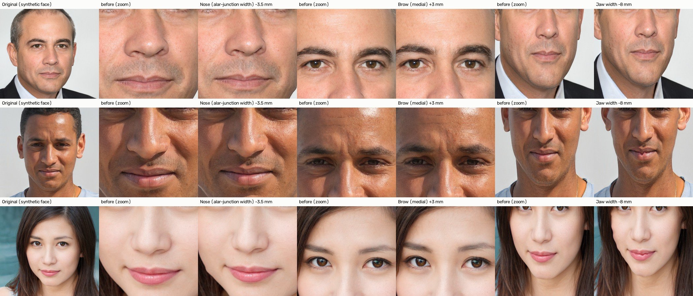
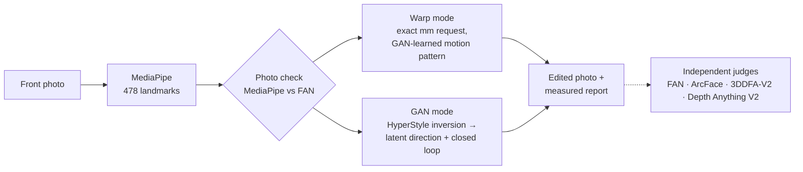

# Yourself (Best)

**Measurement-grounded facial-surgery outcome simulation: GAN inversion, latent-space editing and exact geometric
warping, validated against real before/after surgery photos.**

> Ongoing project, under development.


<sub>Warp mode on GAN-generated (synthetic) faces: alar width −3.5 mm, medial brow +3 mm, jaw width −8 mm (approx. mm).</sub>

---

## What it does

From one front-facing photo, a clinician requests region-wise changes in approximate millimetres. The tool renders
the change and **measures what it did**, reporting requested vs achieved change, the features held fixed and the
published surgical range.

- **Warp mode:** nose width, brow (3 points), upper eyelid (MRD1), jaw width, mouth width and lower-face height. Exact geometry on the person's own photo.
- **GAN mode:** brow and mouth. HyperStyle inversion, a learned latent direction and a closed loop that re-measures and corrects.
- **Photo check:** two independent landmark detectors must agree before any edit.

## How it works



**Latent space ↔ anatomy.**
1. 36,000 synthetic StyleGAN2 faces were measured.
2. Ridge Jacobians link the latent code to each facial measurement.
3. Each feature gets one edit direction, built so that it leaves the other measured features unchanged (null-space constraints).
4. The motion pattern of these edits also drives warp mode.

**Evaluation rules.**
- Every test was pre-registered before it ran (`outputs/eval_plan.json`).
- Dev and test splits are separated by person. Everything is built and tuned on dev photos; test photos are only
  evaluated, under rules fixed before each run.
- Confidence intervals come from a subject-level bootstrap, with Holm correction when many things are tested at once.
- Independent judges are never used to make the edits they judge.

## Key results

All results come from **held-out test photos**: about 440 people the system never saw while it was being built. The
test rules were fixed before each run.

| What we checked | What we found |
|---|---|
| **Can it reproduce a real surgery result?**<br/>For each patient we applied the amount of change they really had to their *before* photo and compared the simulation with their real *after* photo. | On the operated feature, the simulated face lands within **0.4–0.7 mm** of the real result (brow 0.4, nose 0.6, jaw 0.6, mouth 0.7 mm), for real before-to-after changes of 0.9–1.9 mm.<br/>*436 patients* |
| **Does the change move the face the way real surgery does?** | Our learned motion pattern matches real nose surgery **twice as well** as a standard smooth warp (agreement 0.48 vs 0.24).<br/>*27 patients with a real nose change* |
| **Which encoder keeps the person's identity?**<br/>(the step that turns a photo into the GAN's code) | Our HyperStyle-based pipeline: rebuilds look like the real person in **100 %** of faces (standard e4e encoder: 42 %). Fine-tuning e4e on our data was also tested; it did not help, so it is not used.<br/>*440 faces* |
| **Does "re-measure and correct" improve GAN edits?** | Yes. Brow edits that hit the requested size with no side effects: **87 %** (a single uncorrected edit: 48 %).<br/>*440 faces* |
| **Can it spot an unreliable photo?** | A second, independent landmark detector catches **87–88 %** of photos with a covered eye or mouth, and wrongly flags **6.7 %** of good photos. |

GAN mode is limited to brow and mouth: nose and eyelid GAN edits did not pass the independent 3D and landmark
checks, so those features use warp mode. Full numbers: [`outputs/RESULTS.md`](outputs/RESULTS.md).

## Repository

```
src/medsg/          core package: measurement, judges, GAN + inversion, latent directions, warp engine
src/medsg/stages/   experiments, Stages 1–9 (GPU stages run on Kaggle T4; analyses on CPU)
src/medsg/assets/   frozen aggregate numbers used by the app (directions, noise floors, calibration)
app/                Gradio app (warp mode, GAN mode, photo check) + synthetic example faces
tools/              asset builders, figures, smoke tests, app bundler
tests/              unit tests
outputs/            results summary, result figures, pre-registered test rules
```

## Quick start

Python 3.12 (Linux/Windows; the pinned torch build is CPU-only).

```bash
pip install -r app/requirements.txt pytest
pytest -q                                                         # 27 unit tests, no dataset needed

git clone https://github.com/yuval-alaluf/hyperstyle repos/hyperstyle
python tools/build_space.py && cd build/space && python app.py    # http://127.0.0.1:7860
```

Model weights download on first start (≈ 1.7 GB), and the HyperStyle weights load only if their SHA-256 matches the
official release. The first request warms up for about 1 min. After that, a warp edit takes ≈ 2.5 s and a GAN-mode
request 1–3 min on CPU (≈ 1 s on a GPU). Set `MEDSG_GAN_MODE=0` for warp mode only.

## Dataset and acknowledgement

This work uses the **HDA Plastic Surgery Face Database**: 662 pre/post-operative image pairs. File names use `_b`
for pre-op and `_a` for post-op. **No dataset image is included in this repository**, and no model trained on it is
released. We sincerely thank **Christian Rathgeb, Didem Dogan, Fabian Stockhardt, Maria De Marsico and Christoph
Busch** for making the dataset available for research.

> C. Rathgeb, D. Dogan, F. Stockhardt, M. De Marsico, C. Busch, *"Plastic Surgery: An Obstacle for Deep Face
> Recognition?"*, 15th IEEE Computer Society Workshop on Biometrics (CVPRW), pp. 3510–3517, 2020.

```bibtex
@inproceedings{rathgeb2020plasticsurgery,
  author    = {Rathgeb, Christian and Dogan, Didem and Stockhardt, Fabian and De Marsico, Maria and Busch, Christoph},
  title     = {Plastic Surgery: An Obstacle for Deep Face Recognition?},
  booktitle = {15th IEEE Computer Society Workshop on Biometrics (CVPRW)},
  pages     = {3510--3517},
  year      = {2020}
}
```

**Built on:**
- [StyleGAN2](https://arxiv.org/abs/1912.04958)
- [e4e](https://arxiv.org/abs/2102.02766)
- [HyperStyle](https://arxiv.org/abs/2111.15666)
- [PTI](https://arxiv.org/abs/2106.05744)
- [MediaPipe Face Mesh](https://arxiv.org/abs/1907.06724)
- [FAN](https://arxiv.org/abs/1703.07332)
- [ArcFace](https://arxiv.org/abs/1801.07698)
- [3DDFA-V2](https://arxiv.org/abs/2009.09960)
- [Depth Anything V2](https://arxiv.org/abs/2406.09414)

## Disclaimer and license

This simulation isn't a guarantee of being a medical tool at this stage, For research and education, with
adults only. Sizes are approximate (mm via an average inter-pupil distance, ±6 %).
This project is for non-commercial research and education. Third-party licences apply:
- StyleGAN2 weights: NVIDIA Source Code License-NC;
- e4e and HyperStyle: MIT;
- MediaPipe: Apache-2.0;
- face-alignment: BSD-3;
- InsightFace models: non-commercial research only;
- the HDA dataset: according to its authors' terms.
